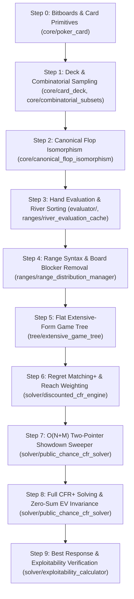

# PokerSolver: Step-by-Step Bottom-Up Verification Guide

This guide provides a structured, incremental roadmap for studying, verifying, and testing the entire **PokerSolver** codebase. Each step builds strictly on the primitives validated in the previous step, starting from bitwise card algebra up to full Counterfactual Regret Minimization (CFR+) equilibrium solving and exploitability verification.

---

## Roadmap Overview



---

## Step 0: 64-Bit Bitboard Card Algebra

**Goal**: Verify how playing cards are encoded as integers and 64-bit masks, enabling card collisions and blockers to be computed in single CPU cycles.

### 1. Code to Inspect
- Header: [`include/poker_solver/core/poker_card.h`](file:///Users/sanch_bo/Documents/poker-solver/include/poker_solver/core/poker_card.h)
- Source: [`src/core/poker_card.cpp`](file:///Users/sanch_bo/Documents/poker-solver/src/core/poker_card.cpp)

### 2. Core Concepts & Formulas

- **Card Index Encoding**:
  ```text
  card_int = rank * 4 + suit
  ```
  - **Suits** (`0 ... 3`): `0 = s` (Spades), `1 = h` (Hearts), `2 = d` (Diamonds), `3 = c` (Clubs)
  - **Ranks** (`0 ... 12`): `0 = 2`, `1 = 3`, ..., `11 = K`, `12 = A` (cards `0 ... 51`)
  - **Concrete Examples**:
    - `As` (Ace of Spades): `12 * 4 + 0 = 48`
    - `Kh` (King of Hearts): `11 * 4 + 1 = 45`
    - `2c` (Deuce of Clubs): `0 * 4 + 3 = 3`

- **64-bit Bitmask Representation**:
  ```text
  card_mask = 1ULL << card_int
  ```

- **Blocker / Board Collision Check (1 CPU Cycle)**:
  ```text
  do_boards_overlap(b1, b2) = ((b1 & b2) != 0)
  ```

### 3. Verification Command
```bash
./build/poker_solver_tests --gtest_filter="PokerCardTest.*"
```
*Expected Result*: Tests pass for card string parsing (`"As"`, `"Td"`), rank/suit extraction, bitboard conversions, and board overlap tests.

---

## Step 1: Decks & Combinatorial Subsets

**Goal**: Verify deck enumeration and combinatorial sampling ($N \text{ choose } K$) used when enumerating turn and river deals.

### 1. Code to Inspect
- Deck: [`include/poker_solver/core/card_deck.h`](file:///Users/sanch_bo/Documents/poker-solver/include/poker_solver/core/card_deck.h) & [`src/core/card_deck.cpp`](file:///Users/sanch_bo/Documents/poker-solver/src/core/card_deck.cpp)
- Combinations: [`include/poker_solver/core/combinatorial_subsets.h`](file:///Users/sanch_bo/Documents/poker-solver/include/poker_solver/core/combinatorial_subsets.h)

### 2. Core Concepts & Formulas

- **Combinations**: `CombinatorialSubsets<T>` produces all unordered subsets:
  ```text
  C(n, k) = n! / (k! * (n - k)!)
  ```
- **Turn Deal Outcomes**: From 49 remaining unseen cards after a 3-card flop:
  ```text
  C(49, 1) = 49 possible turn branches
  ```
- **River Deal Outcomes**: From 48 remaining unseen cards after a 4-card turn:
  ```text
  C(48, 1) = 48 possible river branches
  ```

### 3. Verification Command
```bash
./build/poker_solver_tests --gtest_filter="CardDeckTest.*"
```

---

## Step 2: Canonical Flop Suit Isomorphism

**Goal**: Understand and prove suit symmetry reduction that collapses all 22,100 Hold'em flops into 1,755 canonical abstractions.

### 1. Code to Inspect
- Canonical Flops: [`include/poker_solver/core/canonical_flop_isomorphism.h`](file:///Users/sanch_bo/Documents/poker-solver/include/poker_solver/core/canonical_flop_isomorphism.h) & [`src/core/canonical_flop_isomorphism.cpp`](file:///Users/sanch_bo/Documents/poker-solver/src/core/canonical_flop_isomorphism.cpp)
- Suit Utilities: [`include/poker_solver/core/suit_permutation_utils.h`](file:///Users/sanch_bo/Documents/poker-solver/include/poker_solver/core/suit_permutation_utils.h)
- Verification Script: [`scripts/test_canonical.py`](file:///Users/sanch_bo/Documents/poker-solver/scripts/test_canonical.py)

### 2. Core Concepts & Formulas

- **Equivalence Under Suit Permutation**:
  Any flop like `Ks Qh 2h` is strategically identical to `Kc Qd 2d` under relabeling of suits.
- **Total Unordered Flops**:
  ```text
  C(52, 3) = (52 * 51 * 50) / (3 * 2 * 1) = 22,100 flops
  ```
- **Canonical Partition**:
  Testing all `4! = 24` suit permutations on each flop and selecting the lexicographically maximum tuple collapses all 22,100 flops into exactly **1,755 canonical equivalence classes**.

### 3. Verification Commands
```bash
# Run C++ unit tests
./build/poker_solver_tests --gtest_filter="SuitPermutationUtilsTest.*"

# Run standalone Python verification proof
python3 scripts/test_canonical.py
```
*Expected Output*: `Total canonical flops: 1755`.

---

## Step 3: Hand Strength Evaluation & River Sorting

**Goal**: Validate 5-card and 7-card rank evaluation and pre-sorted river hand caches required for $O(N+M)$ showdown sweeps.

### 1. Code to Inspect
- Evaluator: [`include/poker_solver/evaluator/table_hand_evaluator.h`](file:///Users/sanch_bo/Documents/poker-solver/include/poker_solver/evaluator/table_hand_evaluator.h) & [`src/evaluator/table_hand_evaluator.cpp`](file:///Users/sanch_bo/Documents/poker-solver/src/evaluator/table_hand_evaluator.cpp)
- River Cache: [`include/poker_solver/ranges/river_evaluation_cache.h`](file:///Users/sanch_bo/Documents/poker-solver/include/poker_solver/ranges/river_evaluation_cache.h) & [`src/ranges/river_evaluation_cache.cpp`](file:///Users/sanch_bo/Documents/poker-solver/src/ranges/river_evaluation_cache.cpp)

### 2. Core Concepts

- **Precomputed 5-Card Dictionary (`table_hand_evaluator`)**:
  - Maps 5-card hand hashes to integer ranks (`Rank 1 = Royal Flush`, `Rank 7462 = 7-5-4-3-2 offsuit`).
  - **Rule**: Lower rank number = stronger hand. Hand $A$ beats Hand $B$ if $\text{rank}(A) < \text{rank}(B)$.
  - Binary disk cache (`build/five_card_strength.bin`) accelerates initialization from ~1,500ms down to ~3ms.
- **River Strength Sorting (`river_evaluation_cache`)**:
  - For a concrete 5-card board, evaluates all legal hero and villain hole card combos.
  - Sorts them in **descending order of strength** (strongest hand first).
  - Flags and excludes dead combos that intersect the board bitmask.

### 3. Verification Commands
```bash
./build/poker_solver_tests --gtest_filter="TableHandEvaluatorTest.*:RiverEvaluationCacheTest.*"
```

---

## Step 4: Range Syntax Parsing & Reach Distributions

**Goal**: Verify string range parsing (`"AA,AKs,QTo:0.5"`) and initial reach probability calculation with board blocker removal.

### 1. Code to Inspect
- Range Parser: [`include/poker_solver/ranges/range_syntax_parser.h`](file:///Users/sanch_bo/Documents/poker-solver/include/poker_solver/ranges/range_syntax_parser.h) & [`src/ranges/range_syntax_parser.cpp`](file:///Users/sanch_bo/Documents/poker-solver/src/ranges/range_syntax_parser.cpp)
- Combos: [`include/poker_solver/ranges/hole_card_combination.h`](file:///Users/sanch_bo/Documents/poker-solver/include/poker_solver/ranges/hole_card_combination.h) & [`src/ranges/hole_card_combination.cpp`](file:///Users/sanch_bo/Documents/poker-solver/src/ranges/hole_card_combination.cpp)
- Range Manager: [`include/poker_solver/ranges/range_distribution_manager.h`](file:///Users/sanch_bo/Documents/poker-solver/include/poker_solver/ranges/range_distribution_manager.h) & [`src/ranges/range_distribution_manager.cpp`](file:///Users/sanch_bo/Documents/poker-solver/src/ranges/range_distribution_manager.cpp)

### 2. Core Concepts & Multiplicity Formulas

- **Combo Multiplicity in Hold'em**:
  ```text
  Pocket Pairs (e.g., AA) : C(4, 2)  = 6 combinations
  Suited Hands (e.g., AKs) : 4 suits  = 4 combinations  (ss, hh, dd, cc)
  Offsuit Hands (e.g., AKo): 4 * 3    = 12 combinations
  -------------------------------------------------------------
  Total combos for rank pair : 6 + 4 + 12 = 16 combinations
  Total preflop combinations : 1,326 combinations
  ```
- **Board Blocker Removal**:
  - If the board contains `As`, any combination containing `As` has its reach probability set strictly to `0.0`.
  - Non-blocked hand probabilities are normalized so total reach mass sums to `1.0`.

### 3. Verification Commands
```bash
./build/poker_solver_tests --gtest_filter="RangeSyntaxParserTest.*:RangeDistributionManagerTest.*:HoleCardCombinationTest.*"
```

---

## Step 5: Flat Extensive-Form Game Tree

**Goal**: Verify that the extensive-form poker tree builds valid action, chance, terminal, and showdown topologies with zero-sum payoff guarantees.

### 1. Code to Inspect
- Tree Definition: [`include/poker_solver/tree/extensive_game_tree.h`](file:///Users/sanch_bo/Documents/poker-solver/include/poker_solver/tree/extensive_game_tree.h) & [`src/tree/extensive_game_tree.cpp`](file:///Users/sanch_bo/Documents/poker-solver/src/tree/extensive_game_tree.cpp)
- Betting Rules: [`include/poker_solver/tree/tree_building_config.h`](file:///Users/sanch_bo/Documents/poker-solver/include/poker_solver/tree/tree_building_config.h) & [`src/tree/tree_building_config.cpp`](file:///Users/sanch_bo/Documents/poker-solver/src/tree/tree_building_config.cpp)
- Node Types: [`include/poker_solver/tree/game_tree_node_types.h`](file:///Users/sanch_bo/Documents/poker-solver/include/poker_solver/tree/game_tree_node_types.h)

### 2. Key Invariants & Formulas

- **Contiguous Flat Vector Storage**:
  Nodes are indexed by `NodeRef { type, index }` into flat arrays (no pointer bloat or virtual dispatch overhead).
- **Fold Payoff Invariance (Zero-Sum Conservation)**:
  If player `i` folds:
  ```text
  payoff[folder] = -current_commit
  payoff[winner] = +current_commit
  ---------------------------------
  payoff[0] + payoff[1] = 0.0
  ```
- **Turn Order**:
  - Preflop starts with Player 0 (SB); postflop streets start with Player 1 (OOP).
- **All-In Bypass**:
  When players are effectively all-in, subsequent action rounds are skipped directly to Chance card dealing or Showdown.

### 3. Verification Commands
```bash
./build/poker_solver_tests --gtest_filter="TreeBuildingConfigTest.*:ScenarioGameRuleTest.*"
```

---

## Step 6: CFR+ Regret Matching & Hero Reach Weighting

**Goal**: Verify regret truncation (clamping negative regrets to 0) and average strategy accumulation weighted by the hero's reach probability.

### 1. Code to Inspect
- Regret Engine: [`include/poker_solver/solver/discounted_cfr_engine.h`](file:///Users/sanch_bo/Documents/poker-solver/include/poker_solver/solver/discounted_cfr_engine.h) & [`src/solver/discounted_cfr_engine.cpp`](file:///Users/sanch_bo/Documents/poker-solver/src/solver/discounted_cfr_engine.cpp)
- Action Traversal: [`src/solver/public_chance_cfr_solver.cpp`](file:///Users/sanch_bo/Documents/poker-solver/src/solver/public_chance_cfr_solver.cpp) (`cfr_action_node`)

### 2. Core Equations

1. **Regret Matching+ (Next-Iteration Action Probabilities)**:
   For each action `a` at information set `h`:
   ```text
   R_plus[a] = max(0.0, cumulative_regret[a])

   strategy[a] = R_plus[a] / sum(R_plus)      (if sum(R_plus) > 0)
               = 1.0 / num_actions            (if sum(R_plus) == 0)
   ```

2. **CFR+ Regret Clamping**:
   At each iteration `t`, instantaneous counterfactual regrets `r_t[a]` are added, and negative sums are clamped to zero:
   ```text
   cumulative_regret[a] = max(0.0, cumulative_regret[a] + r_t[a])
   ```

3. **Linear Average Strategy Accumulation (Hero Reach Weighted)**:
   ```text
   cumulative_strategy[a] += t * reach_prob_hero * current_strategy[a]
   average_strategy[a]    = cumulative_strategy[a] / sum(cumulative_strategy)
   ```
   > **Note on Reach-Probability Weighting**: Unweighted CFR strategy accumulation corrupts the equilibrium off the equilibrium path. PokerSolver passes both `reach_probs_0` and `reach_probs_1` concurrently down the tree so strategy averaging is correctly weighted by the acting player's own reach probability.

---

## Step 7: O(N+M) Two-Pointer Showdown Sweeper

**Goal**: Verify how showdown payoffs are calculated in linear time with blocker subtractions instead of $O(N \times M)$ nested loops.

### 1. Code to Inspect
- Method: `CfrPlusSolver::cfr_showdown_node` in [`src/solver/public_chance_cfr_solver.cpp`](file:///Users/sanch_bo/Documents/poker-solver/src/solver/public_chance_cfr_solver.cpp#L675-L780)

### 2. Algorithm Breakdown & Complexity Reduction

Given $N$ hero combos and $M$ opponent combos pre-sorted from strongest to weakest:
1. As the hero hand pointer moves from strongest to weakest, an opponent pointer advances, accumulating cumulative winning mass (`win_mass`).
2. Direct card blocker collisions are subtracted in $O(1)$ using `oppo_mass_by_card[52]`.
3. Total comparisons drop from $\sim 1,750,000$ down to $\sim 1,300$ operations per river showdown node:
   ```text
   O(N * M)  -->  O(N + M)
   ```

---

## Step 8: Full CFR+ Solving & Zero-Sum EV Invariance

**Goal**: Run end-to-end solving on full river and flop scenario trees, and verify that the zero-sum expected value conservation holds: $EV_{P0} + EV_{P1} = 0.0$.

### 1. Code to Inspect
- River Scenario: [`test_data/simple_river_scenario.json`](file:///Users/sanch_bo/Documents/poker-solver/test_data/simple_river_scenario.json)
- Flop Scenario: [`test_data/simple_flop_scenario.json`](file:///Users/sanch_bo/Documents/poker-solver/test_data/simple_flop_scenario.json)
- Integration Test: [`tests/public_chance_cfr_integration_test.cpp`](file:///Users/sanch_bo/Documents/poker-solver/tests/public_chance_cfr_integration_test.cpp)

### 2. Verification Commands
```bash
# Run river solving test
./build/poker_solver_tests --gtest_filter="CfrPlusSolverIntegrationTest.SimpleRiverTest"

# Run flop solving test
./build/poker_solver_tests --gtest_filter="CfrPlusSolverIntegrationTest.SimpleFlopTest"
```

### 3. Checkpoints to Observe in Terminal Output
- **River Solve**:
  ```text
  SimpleRiverTest Exploitability (pot=30.00000000): 1.70100170e-04%
  SimpleRiverTest EV P0: -1.50000897e+01, P1: 1.50000897e+01, Sum: 0.00000000e+00
  ```
- **Flop Solve**:
  ```text
  SimpleFlopTest Exploitability (pot=30.00000000): 0.3765%
  SimpleFlopTest EV P0: -8.2050, P1: 8.2050, Sum: -0.0000
  ```
- **Zero-Sum Check**: `Sum` is identically `0.00000000` (within machine epsilon).

---

## Step 9: Best Response & Exploitability Verification

**Goal**: Mathematically verify Nash equilibrium convergence via backward induction best response, and confirm that the metric immediately catches intentional strategy flaws.

### 1. Code to Inspect
- Best Response: [`include/poker_solver/solver/exploitability_calculator.h`](file:///Users/sanch_bo/Documents/poker-solver/include/poker_solver/solver/exploitability_calculator.h) & [`src/solver/exploitability_calculator.cpp`](file:///Users/sanch_bo/Documents/poker-solver/src/solver/exploitability_calculator.cpp)
- Vulnerability Test: [`tests/public_chance_cfr_integration_test.cpp`](file:///Users/sanch_bo/Documents/poker-solver/tests/public_chance_cfr_integration_test.cpp#L417) (`InjectedVulnerabilityStressTest`)

### 2. Exploitability Formulation

```text
Total Exploitability Chips = BR_EV(Player 0) + BR_EV(Player 1)

Exploitability (%)          = (Total Exploitability Chips / (2 * Initial Pot)) * 100.0%
```

At an exact Nash Equilibrium:
```text
BR_EV(Player 0) + BR_EV(Player 1) = 0.0 chips  ==>  0.0% exploitability
```

### 3. The Injected Vulnerability Experiment
The test solves the river game to equilibrium, computes baseline exploitability, and then injects three common poker leaks:
```text
Baseline Nash Equilibrium      : 0.00017% exploitability
Leak 1: Calling Station (IP calls 100% vs Bet)  : 25.00000% exploitability
Leak 2: Naked Fold (OOP folds 100% vs Bet)      : 43.93070% exploitability
Leak 3: Naked Bluff (IP bets 100% after Check)  : 25.00000% exploitability
Restored Equilibrium Strategy                   : 0.00017% exploitability
```

### 4. Verification Command
```bash
./build/poker_solver_tests --gtest_filter="CfrPlusSolverIntegrationTest.InjectedVulnerabilityStressTest"
```

---

## Step 10: Interactive GUI Verification

**Goal**: Visually explore the solved strategy using the native desktop GTO Strategy Explorer.

### Verification Commands
```bash
# Launch interactive Strategy Explorer
./build/test_explorer test_data/custom_gui_scenario.json

# Or launch the main GUI dashboard
./build/poker_solver_ui
```

### Visual Checkpoints in the Explorer
1. **Game Tree**: Click nodes to navigate through checks, bets, and chance runouts. Notice board texture updates in the header.
2. **13×13 Matrix**: Observe horizontal action bars representing mixed strategies. Toggle `Strategy`, `EV + Strategy`, and `EV` buttons.
3. **Blocker Handling**: Click any hand category (e.g., `AKo`). Dead combinations containing cards on the board are marked as `[BLOCKED]` with dashed outlines.
